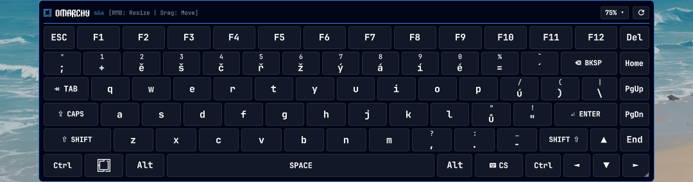

# Virtual Keyboard & Layout (`simonez.vkeyboard`)

[](https://github.com/simonezpx3/omarchy-vkeyboard/releases/tag/v1.7.1)
[](https://github.com/simonezpx3/omarchy-vkeyboard/actions/workflows/ci.yml)
[](https://github.com/omacom/omarchy)
[](https://wayland.freedesktop.org/)
[](https://omarchyplugins.com/plugin.html?id=simonez.vkeyboard)
[](LICENSE)

An advanced, non-focus-stealing On-Screen Virtual Keyboard (OSK) for Omarchy Linux and Hyprland. Built on the **Omarchy Quattro** service architecture, featuring direct `wtype` keystroke injection, system shortcut dispatching, dynamic multi-language XKB layout switching, and unified CRT Monolithic Grid styling.



---

## 1. Architecture

* **Non-Focus-Stealing Layer-Shell:** Runs on `WlrLayer.Overlay` with `WlrKeyboardFocus.None` and `ExclusionMode.Ignore`. Key clicks inject directly into the focused window without interrupting your workflow or text cursor.
* **Wayland Virtual Keyboard Protocol:** Keystrokes stream through `zwp_virtual_keyboard_v1` on the active `wl_seat`.
* **Quattro Headless Singleton (`Service.qml`):** Core state, XKB status monitoring, modifier tracking, and Hyprland IPC run in a dedicated background service separate from the bar widget UI.

---

## 2. Features

### Bar Widget & Quick Settings
* **Left Click:** Toggles the on-screen virtual keyboard overlay.
* **Right Click:** Opens the Quick Settings Panel:
  * **Dynamic Multi-Layout Detection:** Automatically queries and switches between configured system XKB layouts (`us`, `cz`, `sk`, `de`, `fr`, `es`, `pl`, `ua`, etc.).
  * **6 Hardware Formats:** 60%, 65%, 75%, 80% (TKL), Full Size (with Numpad), and macOS layout.
  * **Opacity Slider:** 25%–100% smooth transparency adjustment.
  * **Header Visibility:** Clean borderless layout toggle.

### System Shortcut Dispatcher (`SUPER`)
* Transparently handles compositor-level keybindings when `SUPER` is active:
  * `SUPER + SPACE` → Application launcher
  * `SUPER + RETURN` → Terminal emulator
  * `SUPER + W` → Close active window
  * `SUPER + F` → Toggle fullscreen
  * `SUPER + 1..9` → Switch workspaces

### Navigation & Media Controls
* Native `Page_Up`, `Page_Down`, `Home`, `End`, `PrtSc` (direct screenshot capture), `Calc`, and audio volume (`wpctl`).
* Clean character dispatching preserving national layout diacritics without double-shift collisions.

---

## 3. Installation & Removal

### From Omarchy Marketplace (Recommended)
```bash
omarchy plugin add simonez.vkeyboard --enable
```

### Local Development / Manual Installation
```bash
./install.sh
```

### Removal
```bash
omarchy plugin remove simonez.vkeyboard
# or manually:
./uninstall.sh
```

---

## 4. Control Interfaces

### Native Quickshell IPC
Controls the running Quattro service directly via IPC:
```bash
quickshell ipc call simonez.vkeyboard toggleOsk
quickshell ipc call simonez.vkeyboard switchLayout en
quickshell ipc call simonez.vkeyboard switchFormat "65%"
quickshell ipc call simonez.vkeyboard sendKey "Return"
```

### CLI Tool (`vkeyboard-ctl`)
```bash
vkeyboard-ctl status              # Show active layout & system configuration
vkeyboard-ctl switch en          # Switch layout to English (US)
vkeyboard-ctl switch cs          # Switch layout to Czech
vkeyboard-ctl toggle             # Toggle between configured layouts
vkeyboard-ctl dispatch space super    # Dispatch Super+Space
vkeyboard-ctl key Page_Up shift       # Send Shift+Page_Up
vkeyboard-ctl text "Hello World"      # Type arbitrary text string
```

---

## License

MIT License. See [LICENSE](LICENSE) for details.
